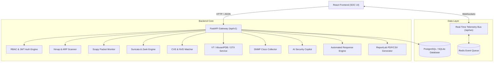

# CyberSentinel Architecture Documentation

## 1. Overview
CyberSentinel is an enterprise-grade Network Security Monitoring (NSM), Security Information and Event Management (SIEM), Intrusion Detection System (IDS), and Vulnerability Assessment platform designed for Security Operations Centers (SOCs).

## 2. System Architecture

## 3. Core Modules

### 3.1 Network Discovery & Device Inventory
- Automatic ARP and ICMP subnet sweeping using Scapy and socket probing.
- MAC OUI vendor matching (Cisco, Dell, Apple, VMware, Ubiquiti, Raspberry Pi, Intel).
- Operating system detection based on TCP window sizes and TTL values.
- Real-time rogue device detection flagging unapproved MAC addresses on authorized VLANs.

### 3.2 Port Scanning & Service Audit (Nmap Integration)
- Real command-line Nmap execution with profiles: Quick Scan, Standard Scan, Full Port Scan, and Service Detection Scan.
- Safe rate limiting to prevent network disruption.
- Port risk classification (Critical, High, Medium, Low, Info).
- Target validation ensuring only administrator-authorized CIDRs can be audited.

### 3.3 Traffic Analyzer
- Live packet monitoring across TCP, UDP, TLS, HTTP, DNS, ICMP, and SSH protocols.
- Bandwidth tracking, packet rate calculation, and TCP retransmission anomaly detection.
- Deep packet inspection with hex and header breakdown.

### 3.4 Intrusion Detection System (Suricata & Zeek)
- Rule-based detection for port scanning, ARP poisoning, DNS exfiltration, SYN floods, and brute-force attacks.
- Distinguishes between confirmed rule matches and behavioral heuristic deviations.

### 3.5 Vulnerability Management & CVE Mapping
- Automated correlation of detected service banners with known CVEs.
- CVSS 3.1 score aggregation with severity categorization.
- Real-time NIST NVD REST API querying with fallback verified offline records.

### 3.6 Cisco Infrastructure Monitoring (SNMP)
- Supports Cisco Catalyst switches and ISR routers via SNMPv2c/SNMPv3.
- Monitors interface bandwidth, CRC/FCS frame errors, discards, and link flapping.
- Automated configuration security auditor checking for Telnet, unencrypted passwords, weak SNMP, and missing BPDU guard.

### 3.7 AI Security Copilot
- SOC assistant capable of explaining alerts, triaging CVEs, analyzing attack vectors, and recommending remediation playbooks without hallucinations.
- Supports Google Gemini and OpenAI with an offline SOC Expert Knowledge Engine fallback.

### 3.8 Automated Security Response
- Firewall block rules and switchport isolation proposals.
- Strict dual-authorization model requiring explicit administrator approval for all disruptive actions.
- Automatic rollback command generation and full audit trail.
